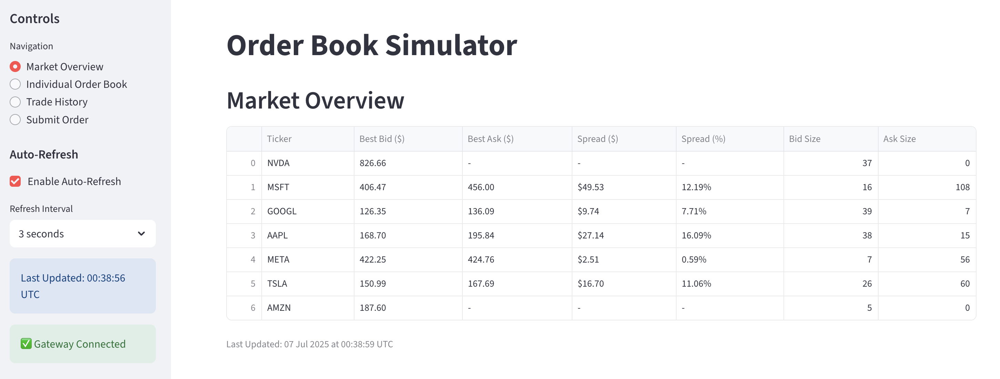
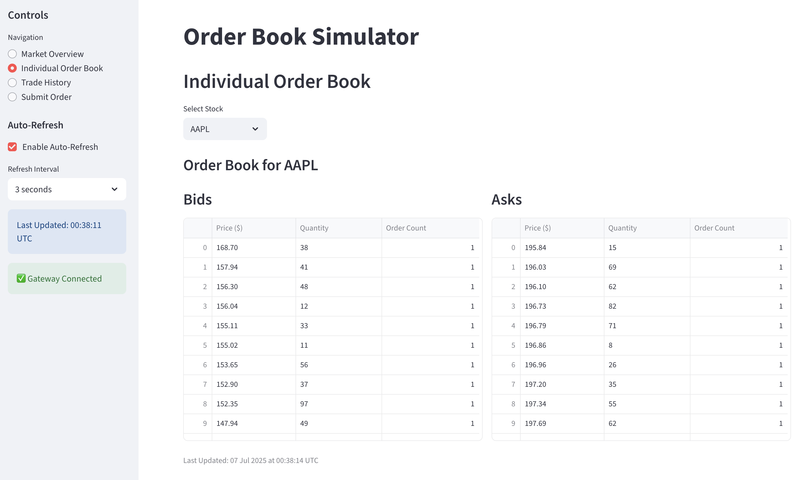
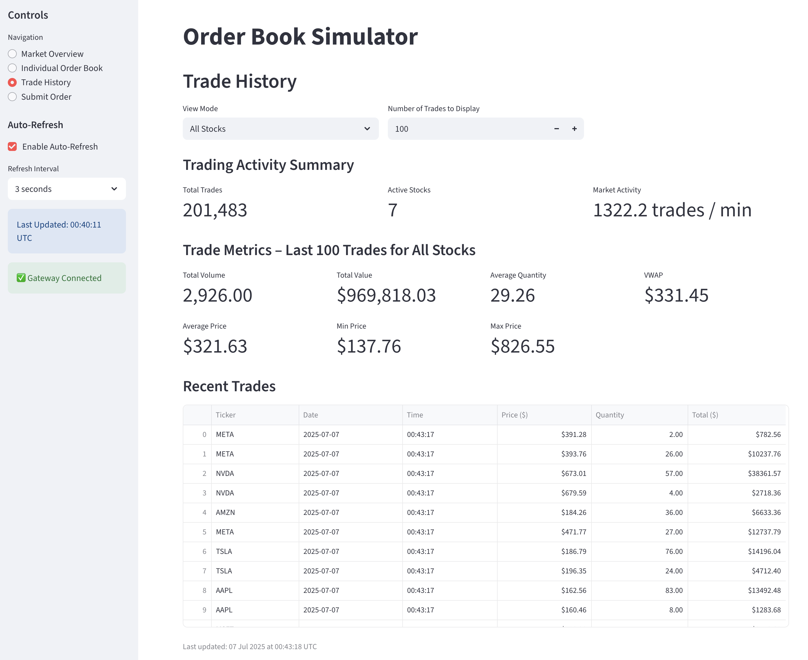
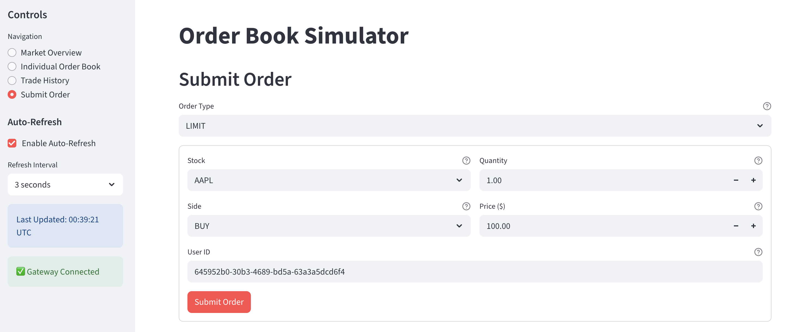
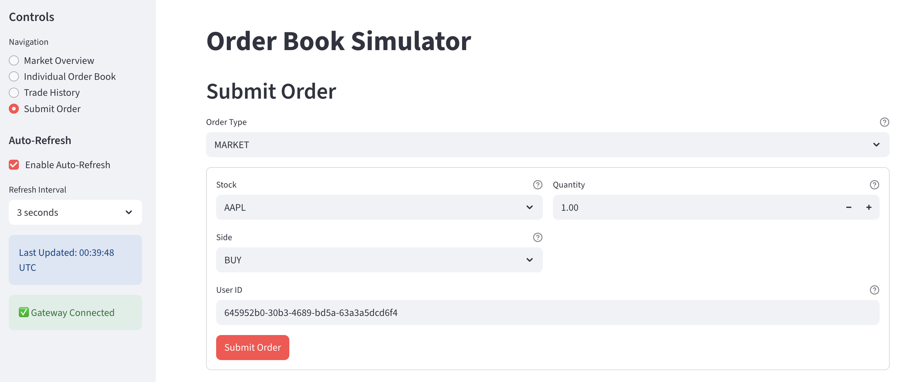

# Order Book Simulator

[](https://github.com/astral-sh/ruff)
[](https://github.com/IsaacCheng9/order-book-simulator/actions/workflows/test.yml)

An equity order matching engine simulating US stock exchange mechanics with an
interactive dashboard, built in Python. Features price-time priority matching,
automated trade execution, real-time market data processing, advanced analytics,
and full REST API access via FastAPI.

## Key Features

- **Order matching engine** – price-time priority matching for limit and market
  orders, with deterministic Kafka `orders` journal replay on startup to
  rebuild resting books, per-symbol delta sequences, and Redis state
- **Real-time market data via WebSocket streaming** – server-push delta fan-out
  with atomic snapshot-plus-sequence bootstrap, per-client bounded queues that
  disconnect overflowing consumers with close code `1008` to resync, supervised
  Redis Pub/Sub fan-out, and 86.1% payload bandwidth reduction over full
  snapshots (111.4 μs p50 over `127.0.0.1` TCP loopback; see
  [benchmark results](#websocket-benchmark-results))
- **UDP multicast market data feed (experimental)** – per-symbol binary wire
  format (`!BQHB` + UTF-8 symbol) with exact `[expected, target)` gap recovery,
  stale-snapshot rejection, and heartbeat liveness (49.7 μs p50 one-way
  delivery over `127.0.0.1` UDP loopback; the publisher is wired into the
  matching service, while the subscriber is a standalone reference client not
  deployed in Docker Compose)
- **Delta publishing** – sequence-based incremental order book updates with
  bounded buffer and atomic snapshot fallback
- **Truthful order ledger and idempotent persistence** – versioned Kafka event
  contracts with semantic validation, deterministic UUIDv5 fill IDs, monotonic
  PostgreSQL `order_` upserts (including resting, partially filled, filled, and
  cancelled orders), and conflict-safe trade writes
- **Advanced analytics** – `Decimal`-exact VWAP calculations across all fills
  in Redis and PostgreSQL, trade metrics, and market activity tracking
- **Interactive web-based Streamlit dashboard** – market monitoring, analysis,
  and order submission
- **REST API via FastAPI** – full programmatic access with comprehensive
  documentation and degraded `/v1/health` reporting (`503` on Redis fan-out or
  Kafka producer failures)
- **Market simulation tool** – automated order generation with deadlock-free
  cancellation and shutdown
- **Containerised deployment** – Docker Compose stack with automated smoke and
  `SIGKILL` + empty-Redis crash-recovery verification in CI

## Screenshots






<!-- markdownlint-disable-next-line MD033 -->
<details>
<!-- markdownlint-disable-next-line MD033 -->
<summary>Trade History (Single Stock)</summary>


</details>

<!-- markdownlint-disable-next-line MD033 -->
<details>
<!-- markdownlint-disable-next-line MD033 -->
<summary>Submit Market Order</summary>



</details>

## Components

### Order Book Services

The order book services handle order processing, matching, and market data
dissemination. We expose the services via a FastAPI gateway service which
enables the user to interact with the services via REST API calls.

The system consists of five main services:

- **Gateway Service**: REST API and WebSocket service that handles incoming
  orders, market data requests, and real-time streaming
- **Matching Engine**: Processes orders and executes trades using price-time
  priority
- **Market Data Service**: Manages market data dissemination and analytics
- **Database**: Stores order and trade history
- **Streamlit UI**: Interactive web dashboard providing real-time market data
  visualisation, order book analysis, trade history, and order submission

### Market Simulator

The market simulator is a tool that allows you to simulate market activity to
demonstrate how the order book services work. We use the simulator to generate
orders for the order book services to process.

You can find the `MarketSimulator` class in
[src/order_book_simulator/simulator/market_simulator.py](./src/order_book_simulator/simulator/market_simulator.py).
We've also provided an example script in
[examples/market_simulator_usage.py](./examples/market_simulator_usage.py) that
shows how to use the `MarketSimulator` class to simulate market activity.

## Technology Stack

- **FastAPI**: REST API and WebSocket framework for the gateway service
- **Polars**: Data processing and analysis
- **SQLAlchemy**: ORM for the database
- **Pydantic**: Data modelling and validation
- **Kafka**: Message broker for order flow and market data
- **PostgreSQL**: Persistent storage for orders and trades
- **Redis**: Caching for real-time market data and Pub/Sub for WebSocket delta
  fan-out
- **Streamlit**: UI for the interactive web dashboard
- **Docker**: Containerisation and deployment

## Usage

### Installing Dependencies

Run the following command from the [project root](./) directory:

```bash
uv sync --all-extras --dev
```

### Running the Order Book Services

Use Docker Compose to build and run the services locally:

```bash
docker compose up --build
```

From there, you can interact with the services:

- **Streamlit UI**: [http://localhost:8501](http://localhost:8501) – Interactive
  dashboard for market monitoring, analysis, and user-friendly order submission
- **FastAPI Documentation**:
  [http://localhost:8000/docs](http://localhost:8000/docs) – REST API interface
  for programmatic, full-featured access to the order book services

### Resetting the Order Book Services

To reset the order book services, you can stop the services and remove the
containers, images, and volumes:

```bash
docker compose down -v
```

### Running the Market Simulator Example

To run the market simulator, you can use the following command:

```bash
uv run python examples/market_simulator_usage.py
```

### Running Benchmarks

The project includes two categories of benchmarks:

#### Unit Benchmarks (No Docker Required)

```bash
# Benchmark the core order book data structure (pure Python, synchronous).
uv run python benchmarks/unit/order_book_benchmark.py

# Benchmark the full matching engine with mocked I/O.
uv run python benchmarks/unit/matching_engine_benchmark.py

# Benchmark delta payload sizes vs full snapshots.
uv run python benchmarks/unit/delta_payload_benchmark.py

# Benchmark WebSocket fan-out throughput and push latency.
uv run python benchmarks/unit/websocket_benchmark.py

# Benchmark UDP multicast vs WebSocket fan-out scaling.
uv run python benchmarks/unit/multicast_benchmark.py

# Run all unit benchmarks together.
uv run python benchmarks/unit/run_all_benchmarks.py
```

The order book benchmark measures the raw performance of the matching logic and
data structures (higher throughput). The matching engine benchmark measures
end-to-end throughput with mocked dependencies (lower throughput), showing async
orchestration overhead.

##### WebSocket Benchmark Results

> **Note:** The tables below separate in-process async delivery (mock
> `send_json`, 100% of broadcasts drained with zero slow-consumer disconnects)
> from real `127.0.0.1` TCP loopback delivery (FastAPI/Uvicorn server to
> `aiohttp` WebSocket clients, 500 measured operations after 50 warmup
> operations). Measured on Apple Silicon macOS with Python 3.14.0.

In-process async fan-out delivery (broadcast plus `asyncio` sender-task drain
to mock WebSockets, 100% delivered):

| Subscribers | Broadcasts/s | Delivered msg/s (broadcasts × subscribers) | Push Latency p50 (μs) | Push Latency p99 (μs) |
| ----------: | -----------: | -----------------------------------------: | --------------------: | --------------------: |
|           1 |      175,608 |                                    175,608 |                  32.2 |                  90.2 |
|          10 |       13,832 |                                    138,319 |                  92.1 |                 158.8 |
|          50 |        2,648 |                                    132,400 |                 417.6 |               3,667.7 |
|         100 |        1,213 |                                    121,326 |                 907.5 |               4,026.2 |
|         500 |          192 |                                     96,041 |               5,103.5 |              59,616.5 |
|       1,000 |           80 |                                     80,019 |              10,105.1 |             128,057.9 |

Per-client bounded queues isolate slow consumers from other subscribers; any
client whose queue overflows is disconnected with WebSocket close code `1008`
so it reconnects cleanly via atomic snapshot-plus-sequence bootstrap.

Real loopback WebSocket delivery (`OrderBook.add_order` ->
`WebSocketConnectionManager` -> FastAPI/Uvicorn -> `127.0.0.1` TCP -> all
`aiohttp` clients finish JSON decode; multi-subscriber rows measure
all-subscriber fan-out completion across `N` clients, not per-client median):

| Subscribers | Operations | Loopback p50 (μs) | Loopback p95 (μs) | Loopback p99 (μs) |
| ----------: | ---------: | ----------------: | ----------------: | ----------------: |
|           1 |        500 |             111.4 |             133.2 |             161.5 |
|          10 |        500 |             263.6 |             334.5 |             483.2 |
|          50 |        500 |             895.6 |             993.7 |           1,084.7 |

Single-subscriber loopback WebSocket p50 (`111.4 μs`) vs theoretical average
polling wait (`interval / 2`, excluding HTTP polling transport overhead):

| Polling Interval | Theoretical Average Wait (`interval / 2`) | Ratio vs Loopback WS p50 |
| ---------------: | ----------------------------------------: | -----------------------: |
|              1ms |                                     0.5ms |                     4.5x |
|             10ms |                                     5.0ms |                    44.9x |
|             50ms |                                    25.0ms |                   224.4x |
|            100ms |                                    50.0ms |                   448.8x |
|            500ms |                                   250.0ms |                 2,243.8x |
|          1,000ms |                                   500.0ms |                 4,487.7x |

Delta streaming achieves an **86.1% payload bandwidth reduction** over full
snapshots (269 bytes vs 1,938 bytes average per update).

##### UDP Multicast vs WebSocket Benchmark Results

> **Note:** The scaling tables compare mocked-I/O CPU and scheduling cost
> (single UDP `encode` + mocked `sendto` vs N WebSocket enqueues plus async
> drain with 100% delivery). The loopback figure below measures real one-way
> UDP socket delivery (`OrderBook.add_order` -> `MulticastPublisher.send()` ->
> `MulticastSubscriber.receive_once()`) over `127.0.0.1`.

Publisher-side cost per broadcast (mocked I/O, 100% delivered):

| Subscribers | UDP Multicast (μs/msg) | WebSocket (μs/msg) |     Ratio |
| ----------: | ---------------------: | -----------------: | --------: |
|           1 |                   5.87 |               5.80 |     0.99x |
|          10 |                   5.57 |              67.32 |    12.08x |
|          50 |                   5.69 |             383.92 |    67.49x |
|         100 |                   5.54 |             788.81 |   142.28x |
|         500 |                   5.56 |           4,890.63 |   879.66x |
|       1,000 |                   5.84 |          12,562.52 | 2,151.02x |

Order book to publish/drain latency (mocked I/O, p50):

| Subscribers | UDP Multicast p50 (μs) | WebSocket p50 (μs) |   Ratio |
| ----------: | ---------------------: | -----------------: | ------: |
|           1 |                   20.5 |               38.3 |   1.87x |
|          10 |                   19.2 |              109.5 |   5.72x |
|          50 |                   18.5 |              462.7 |  24.96x |
|         100 |                   18.6 |              903.7 |  48.63x |
|         500 |                   18.0 |            4,930.0 | 273.25x |
|       1,000 |                   18.0 |           10,268.9 | 570.49x |

Over real `127.0.0.1` UDP loopback sockets (500 in-order one-way datagrams
after 50 warmup operations, `OrderBook.add_order` -> `MulticastPublisher` ->
`MulticastSubscriber.receive_once()`), publish-to-receive delivery measured
**49.7 μs p50** (`59.7 μs` p95, `75.5 μs` p99). Unlike WebSocket fan-out,
multicast publisher cost stays `O(1)` regardless of subscriber count, though
the subscriber remains a standalone reference client and is not deployed in
Docker Compose.

#### Integration Benchmarks (Requires Docker Compose)

```bash
# Integration benchmark with real Redis and Kafka.
docker compose up -d redis kafka
sleep 5
uv run python benchmarks/integration/integration_benchmark.py
docker compose down -v
```

The integration benchmark uses real Redis and Kafka, reflecting true production
performance (lowest throughput). This shows the impact of actual I/O operations
and is the most realistic measure of production performance.
